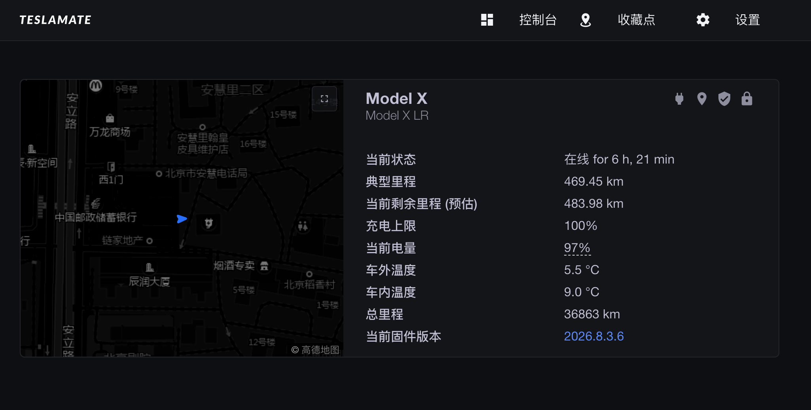
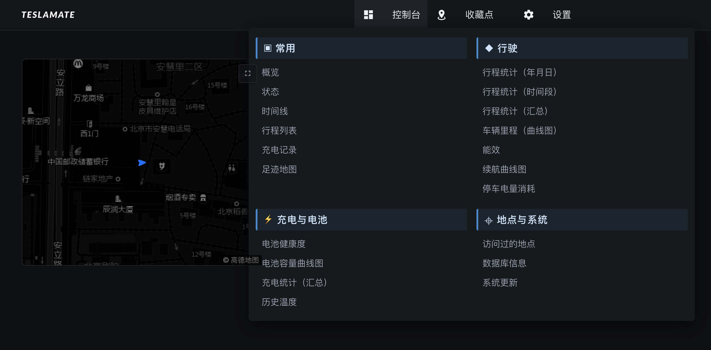
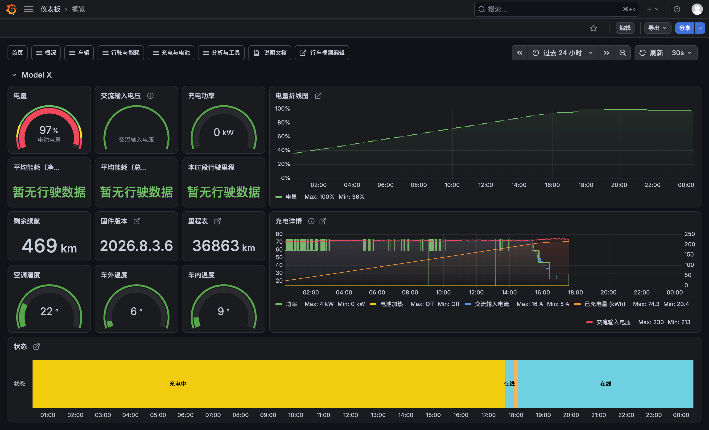
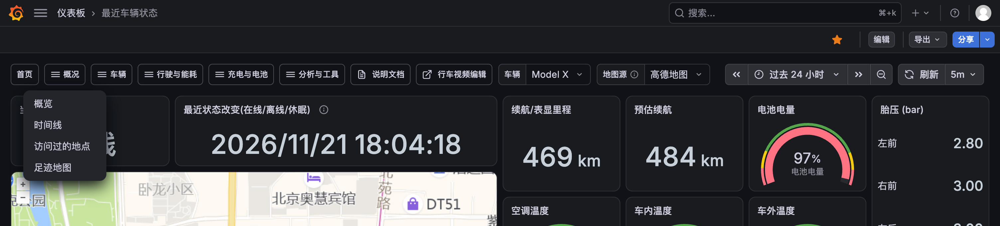
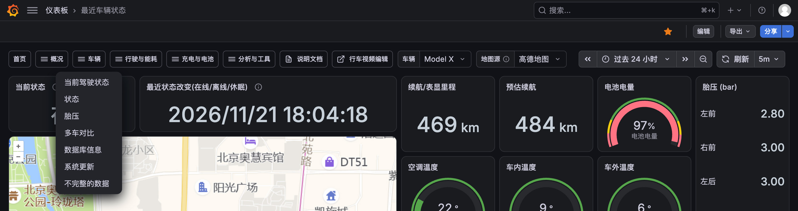
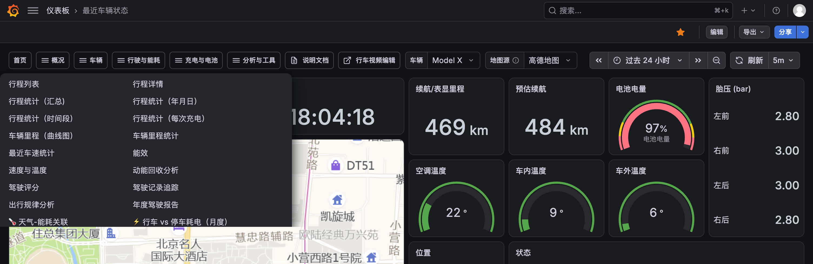
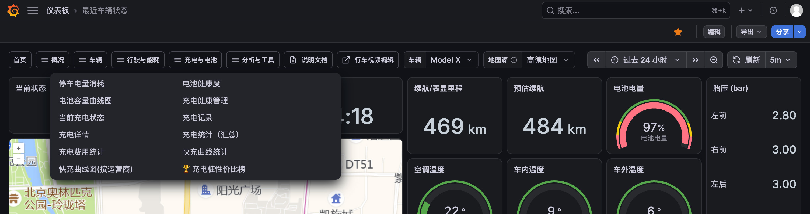
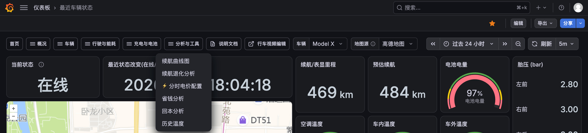

# 👏 欢迎特斯拉 X/S 车主加入车友群

## 小红书搜索：**TXC特斯拉ModelX&S车友会**


---

# TeslaMate CN Patches

面向中国用户的 TeslaMate 二次优化补丁。它建立在 TeslaMate 官方项目之上，并整合指定版本的中文 Grafana 仪表盘：**官方 TeslaMate 安装完成后，只需运行本仓库的一次整合安装即可**。

> 本仓库不包含车辆数据、账号、域名、令牌、私钥、数据库备份或地址库内容。下方效果图来自真实界面，公开使用前请自行确认其中位置与车辆信息是否适合公开。

## 先理解三者关系

| 层级 | 项目 | 作用 |
| --- | --- | --- |
| 1 | [TeslaMate 官方](https://github.com/teslamate-org/teslamate) | 采集车辆状态、行程、充电和位置，提供原生网页。必须先安装。 |
| 2 | [Grafana 中文版仪表盘](https://github.com/wjsall/teslamate-chinese-dashboards) | 为 TeslaMate 数据库提供中文分析仪表盘。必须在官方 TeslaMate 可用后安装。 |
| 3 | **本仓库** | 优化中国地图跳转、原生控制台菜单、Grafana 导航、分类、空数据提示和升级恢复。 |

安装关系为：**官方 TeslaMate → 本仓库的一次整合安装（中文版仪表盘 + 本补丁）**。

## 版本与下载

当前稳定版：[**v1.1.0**](https://github.com/huangkouping/teslamate-cn-patches/releases/tag/v1.1.0)。所有历史版本、变更说明和支持矩阵见 [Releases](https://github.com/huangkouping/teslamate-cn-patches/releases)。

## 当前支持与维护策略

当前已在以下组合完整验证：

- 本补丁：**v1.1.0**
- TeslaMate 官方：**4.5.0**
- `teslamate-chinese-dashboards`：**v1.13.0**
- Grafana：使用该中文版仪表盘随附/要求的版本

详见 [兼容性与版本策略](docs/compatibility.md)。高德底图涉及 TeslaMate 已编译前端资源，严格仅支持 4.5.0；通用菜单、位置跳转与 Grafana 补丁的支持范围也以该页面为准。

TeslaMate 和 Grafana 都会持续演进，升级可能改变前端结构、面板 UID 或仪表盘标题。本仓库会跟踪上游版本变动并同步修订补丁；升级前请阅读 [升级说明](docs/upgrading.md)，升级后按“验证清单”检查。新出现的仪表盘会默认保留，随后可补充分组规则。

## 优化内容

### A. TeslaMate 原生首页与控制台

- 原生控制台菜单中文化，并以“常用、行驶、充电与电池、地点与系统”分组；桌面端以双列展示，避免长菜单超出屏幕。
- 将车辆位置的 Google Maps 跳转改为高德地图，并对中国境内坐标进行 WGS-84 → GCJ-02 转换，避免位置偏移。
- 高德底图为可选的版本专用补丁：仓库提供 TeslaMate 4.5.0 的可复现生成脚本，不包含或分发上游编译资源；脚本会校验原文件版本，未知版本会拒绝执行。

### B. Grafana 中文版仪表盘

- 共享导航统一放在车/地图/时间等筛选器之前，先导航、后筛选。
- 所有仪表盘分为“概况、车辆、行驶与能耗、充电与电池、分析与工具”，保留原有页面，不删除数据分析页面。
- 长菜单自动两列展示；短菜单保留紧凑列表。
- “说明文档”本身不跳转，点击后显示三个外部资源：TeslaMate官方、Grafana 中文版仪表盘、全中文版补丁。
- 概览页的能耗与行驶里程卡片标明“当前时段”；筛选范围内没有行程时显示“暂无行驶数据”，避免被误认为系统故障。

## 效果图

### 原生首页与地图



### 原生控制台分组



### Grafana：概览页面



### Grafana：概况分类



### Grafana：导航优先



### Grafana：车辆分类



### Grafana：行驶双列菜单



### Grafana：分析与工具



## 安装：给首次使用者的完整步骤

**还没有安装 TeslaMate？** 请先阅读并完成 [从零开始：官方 TeslaMate + 中文优化](docs/first-install.md)。该页把官方基础部署、首次 Tesla 授权和本仓库的一次整合安装串成完整流程。

### 先选你的情况（只走一条路径）

| 你的情况 | 最短正确路径 |
| --- | --- |
| 从未安装 TeslaMate | 按 [从零开始安装](docs/first-install.md) 操作，再运行一次整合安装。 |
| 已有官方 TeslaMate，且版本为 4.5.0 | 跳到下方“第 1、2 步”，运行整合安装。 |
| 已有官方 TeslaMate，但不是 4.5.0 | 先按 [升级说明](docs/upgrading.md) 升级到**已验证的 4.5.0**，确认服务正常后再运行整合安装。 |
| 已有中文版仪表盘 | 不要重建数据库；先确认 TeslaMate 是 4.5.0，再按升级说明更新中文版并重跑本仓库的 Grafana 补丁。 |

不要直接追逐“最新”标签：上游发布新版本后，先等待本仓库的兼容性页面和 Release 明确列出支持版本，避免前端地图补丁或仪表盘 UID 不匹配。

### 第 0 步：确认基础服务已正常

先完成 [TeslaMate 官方部署](https://docs.teslamate.org/docs/installation/docker)，并确认能打开 TeslaMate 网页、数据库持续写入数据。**无需单独安装中文版仪表盘**：下一步的整合脚本会锁定 v1.13.0 并调用其官方迁移入口。

如果前两层任一层尚不可用，请先修复它；本仓库不替代它们。

### 第 1 步：下载本仓库

在运行 Nginx、TeslaMate 与 Grafana 的服务器上执行：

```bash
sudo mkdir -p /opt/teslamate-cn-patches
sudo git clone https://github.com/huangkouping/teslamate-cn-patches.git /opt/teslamate-cn-patches
cd /opt/teslamate-cn-patches
```

没有 Git 时，先安装 Git，或在 GitHub 页面下载 ZIP 后解压到同一目录。

### 第 2 步：一次整合安装中文版仪表盘与 Grafana 优化

脚本会先将官方 Grafana 迁移为已验证的中文版仪表盘 v1.13.0，再备份并应用本仓库的 Grafana 分类、导航和概览提示。它不修改 TeslaMate、PostgreSQL 或车辆数据。

```bash
cd /opt/teslamate-cn-patches
sudo bash scripts/install-integrated.sh --compose-file /你的/TeslaMate/compose.yml
```

必须填写 `--compose-file`，安装器会先验证其中使用的是已支持的 TeslaMate 4.5.0，避免把未验证版本直接迁移。运行中会安全地询问 Grafana 管理员密码；密码不会写入仓库或命令历史。标准 Nginx 部署也会自动备份、注入、测试并重载；若服务器有多个站点配置，只需补充 `--nginx-config /实际的站点.conf`。

### 第 3 步：浏览器补丁已在仓库中

克隆完成后，`assets/` 中的两个浏览器补丁已经在目标目录，**不需要再次复制同名文件**。继续执行下一步的 Nginx 注入即可。

### 第 4 步：让 Nginx 向页面注入补丁

打开自己现有的 TeslaMate HTTPS 站点配置，参考 [Nginx 示例](nginx/teslamate-cn-patches.conf.example)。只合并其中的静态脚本 `location` 和 `sub_filter` 片段，**不要覆盖**自己的域名、证书、密码、访问限制或 `proxy_pass`。详细的、可直接验收的步骤见 [安装说明](docs/installation.md)。

完成后检查并重载：

```bash
sudo nginx -t
sudo systemctl reload nginx
```

### 第 5 步：验证

1. 原生 TeslaMate：控制台菜单应中文分组；位置图标应打开高德地图。
2. Grafana：导航位于筛选器前；“说明文档”点击后出现三项菜单。
3. 打开一张行驶/充电相关页面：长菜单应显示为两列。
4. 概览页在最近时间范围内无行程时，能耗/行驶里程应显示“暂无行驶数据”。
5. 如启用了 4.5.0 高德底图补丁：右下角显示“高德地图”，放大地图后仍为高德。

如果未生效，先强制刷新或使用无痕窗口；其次检查 Nginx 配置是否已经注入两个 JavaScript 文件。

## 升级后如何恢复

1. 按官方与中文版仪表盘各自的升级说明完成升级。
2. 确认 TeslaMate、Grafana 和数据库均正常启动。
3. 更新本仓库：`git pull`。
4. 重新执行一次整合脚本；如前端菜单未显示，再检查第 4 步的 Nginx 注入。
5. 参照 [升级与回归验证](docs/upgrading.md) 逐项检查。

## 目录说明

- `assets/`：浏览器端 UI、导航与说明文档菜单补丁。
- `nginx/`：Nginx 合并示例。
- `scripts/`：Grafana 分类、共享导航、概览空数据提示，以及 TeslaMate 4.5.0 高德底图的可重复执行脚本。
- `docs/`：详细安装、Grafana 脚本、升级与验证说明。

## 贡献与安全

欢迎提交可复用改进。请勿提交数据库导出、车辆地址/行程截图、域名、IP、令牌、私钥、密码或现网完整配置。新增菜单请按照实际使用逻辑归入现有分类；如需新增分类，请同步更新脚本与说明文档。

## 许可证

[MIT License](LICENSE)。本许可证只覆盖本仓库自行编写的脚本、配置示例与文档；TeslaMate、Grafana 及中文版仪表盘仍遵循各自的上游许可证。
